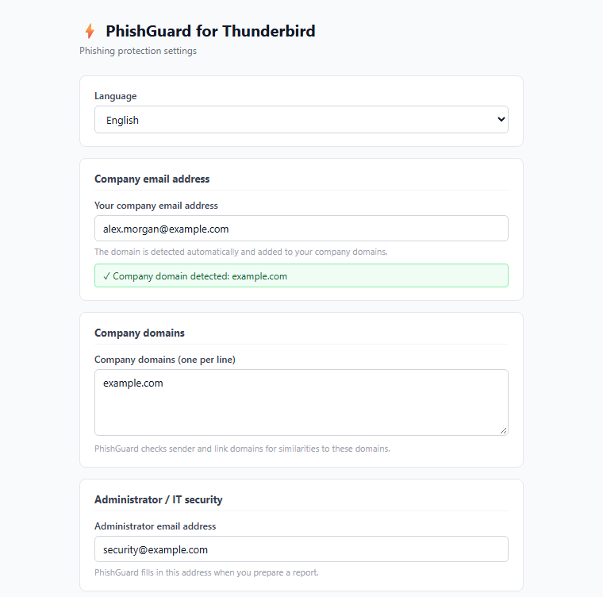
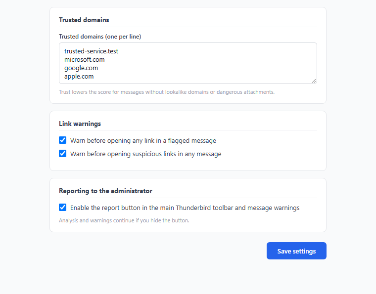
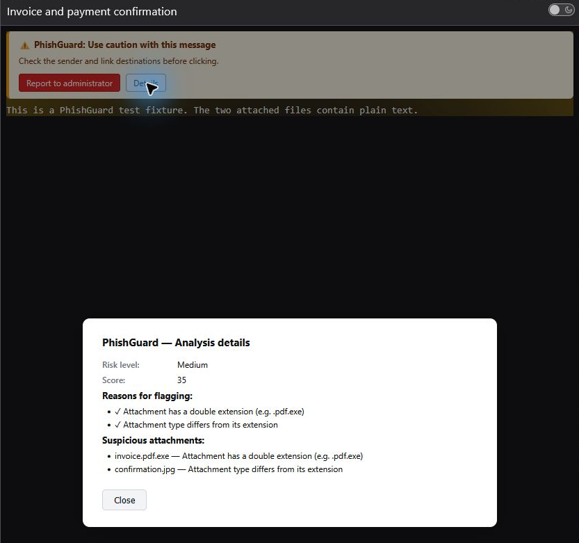
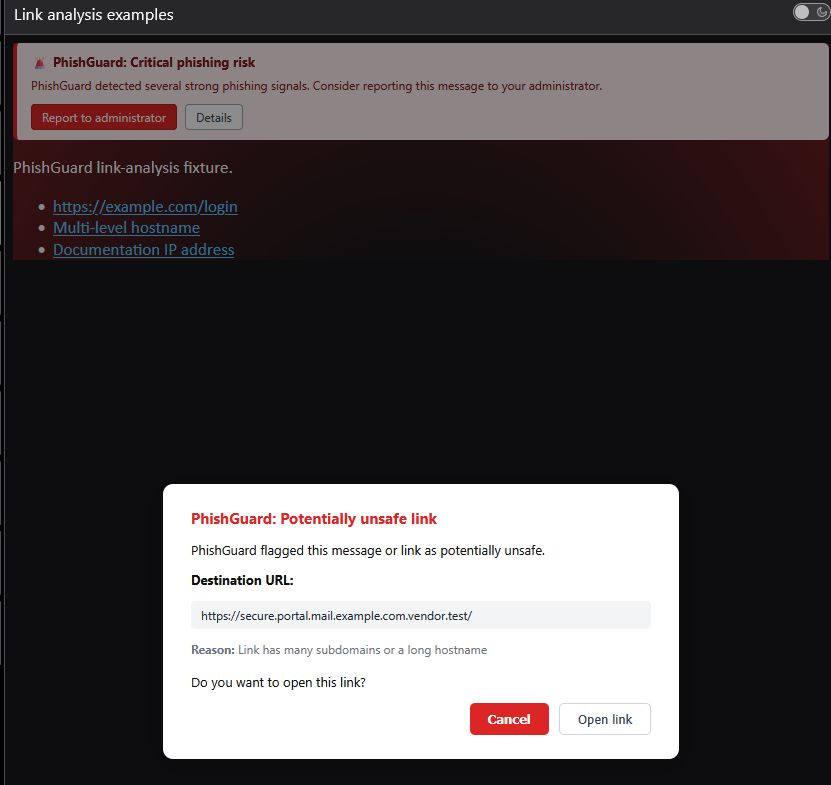
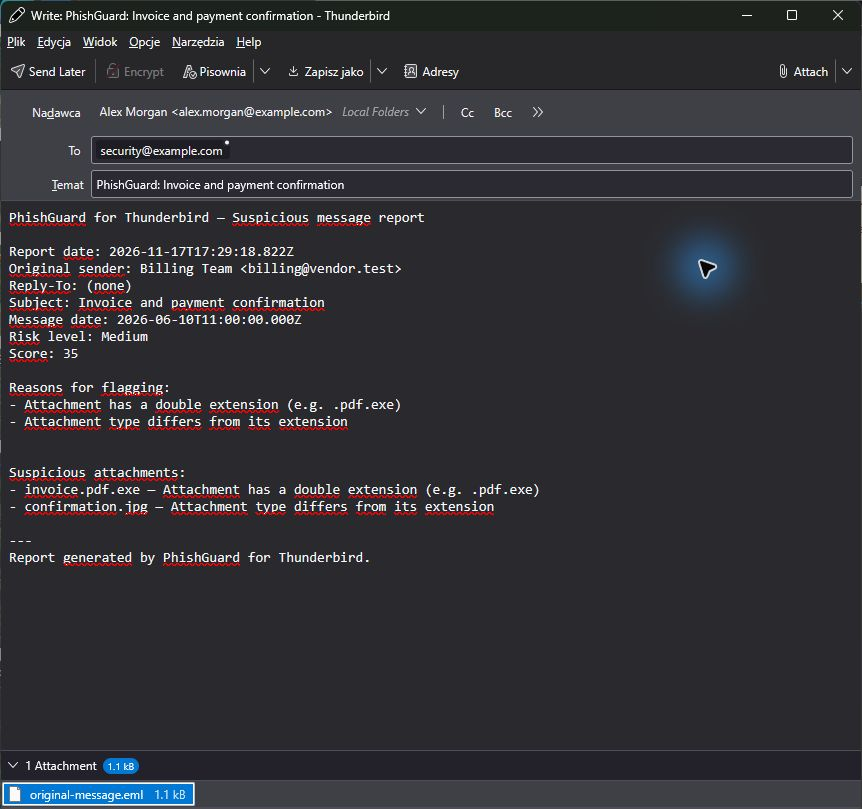

<h1 align="center">
  
  PhishGuard for Thunderbird
</h1>

PhishGuard is a local anti-phishing extension for Thunderbird 128 or later. It flags suspicious messages as you read them and helps you send the original message to your security team.

The warning gives people a chance to reconsider who sent a message, what it asks them to do, and where its links lead. That pause can help reduce the chances of targeted phishing succeeding against a specific employee or department.

## Version 1.0.8

This release reduces false positives from company messages, newsletters, repeated links, and credential keywords embedded in longer words. It adds persistent trust for individual sender addresses and keeps link and attachment checks active for trusted senders.

Warnings and details now use DOM elements and text insertion to display message data. Automated verification includes 41 analyzer and background regression tests.

## Features

- Detects lookalike domains, mixed-script homoglyphs, sender display-name impersonation, and mismatched Reply-To addresses.
- Checks reported SPF, DKIM, and DMARC results, urgency, requests for credentials, and image-heavy messages.
- Flags suspicious links and attachments, including misleading link text, IP address links, executable files, double extensions, and MIME mismatches.
- With link warnings enabled, clicking a link in a flagged message shows the destination and asks you to confirm before opening it. You can cancel and recheck the message.
- Shows a warning above the message with the risk level and analysis details. Lookalike domains, mixed-script homoglyphs, and dangerous attachments cannot be marked safe or have their score reduced by the trusted list.
- Adds **Report phishing** to Thunderbird's main mail toolbar. Reports include the original message as an `.eml` attachment and the subject `PhishGuard: <original subject>`.
- Uses English by default. You can choose Polish in the extension settings.
- Recognizes subdomains of your configured company and trusted domains. Repeated links to the same host and the number of links alone do not inflate the score.
- **Trust sender locally** saves the individual sender address in settings. You can remove it from **Trusted sender email addresses** to revoke trust. Trust reduces weak content signals while checks for impersonation, misleading links, failed authentication, and dangerous attachments continue.

## Company domains and sender trust

Configure your company domains and any trusted external domains in settings. A configured domain includes its genuine subdomains. For example, trusting `atlassian.com` includes `id.atlassian.com` and `track.atlassian.com`. Domains such as `atlassian.net` and `atlassian.com.attacker.test` are separate domains.

Company and sender trust reduce weak urgency and credential-language scores. Messages can still be flagged when they come from a compromised company account. A displayed link URL with a different destination host, a lookalike domain, or a dangerous attachment such as `invoice.pdf.exe` continues to trigger analysis findings. Mismatched link hosts are checked even between subdomains of the same company.

For eligible messages, select **Trust sender locally** to remember the individual sender email address. Reopen settings to see or remove that address under **Trusted sender email addresses**. Messages with restricted findings cannot use this action.

Analysis checks URLs present in the message and attachment names and MIME types. Risk levels summarize the detected indicators. Several indicators can produce a high or critical warning.

## Screenshots

The screenshots use fictional example data.
The settings screenshots show an earlier layout that predates the trusted sender address field.

| Language and company domains | Trust, warnings, and reporting |
| --- | --- |
|  |  |

### Review a flagged message

Select **Details** in the warning banner to see the risk level, score, and reasons. In this example, a double extension and a MIME type mismatch flag the message.

### Confirm before opening a link

With link warnings enabled, PhishGuard shows the destination URL and the reason for the warning before opening a flagged link. Select **Cancel** to stay in Thunderbird or **Open link** to continue.

### Prepare an administrator report

Select **Report to administrator** in the warning banner. Thunderbird opens an unsent draft with the configured administrator address, the original subject prefixed with `PhishGuard: `, and the full original message attached as an `.eml` file. The report body explains why the message was flagged.

The message and report screenshots were captured in Thunderbird using a local test profile. The example report was left unsent.

## Install

1. Build `phishguard.xpi` with `.\build.ps1` in PowerShell or `./build.sh` on macOS or Linux.
2. In Thunderbird, open **Add-ons and Themes → Extensions**. From the gear menu, choose **Install Add-on From File** and select `phishguard.xpi`.
3. Open the PhishGuard options. Enter your company email or domains and your administrator email, then select **Save settings**.
4. Open a message. The **Report phishing** button is in the main toolbar of the Mail space. If you use a customized toolbar and the button is missing, open **Customize** and add it there.

The Bash build requires the `zip` utility. Both build scripts package the manifest and source files directly.

## Report a message

Select a message and choose **Report phishing** from the main toolbar, or choose **Report to administrator** from its warning banner. Review the address, report text, and `.eml` attachment in the compose window, then send the report manually.

## Test with local fixtures

Run `node tools/selftest.js` to check the analyzer. To test inside Thunderbird, import the [sample messages](test-emails/README.md) into a local folder and follow the [manual checks](TESTING.md).

## Privacy

Analysis runs locally. Settings, trusted sender addresses, and a history of up to 200 link-warning decisions are stored in Thunderbird's local extension storage. The history records the URL, the confirmation or cancellation action, and its time.

The extension does not send telemetry. Reporting opens a compose window addressed to the configured administrator, with the analysis and original email attached. You review the draft and choose when to send it. Confirming a link warning opens the displayed destination in your default browser.

## License

PhishGuard is available under the [MIT License](LICENSE).
